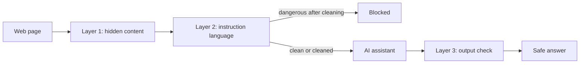

<p align="center">
  <picture>
    <source media="(prefers-color-scheme: dark)" srcset="logo/png/logo-lockup-on-dark.png">
    
  </picture>
</p>

<p align="center">
  <b>A three-layer security filter that stops hidden instructions on web pages from hijacking AI assistants.</b><br>
  <a href="https://injection-shield.onrender.com">Live demo</a> ·
  Demo video: VIDEO_LINK_HERE ·
  <a href="docs/ARCHITECTURE.md">Architecture</a> ·
  <a href="docs/THREAT_MODEL.md">Threat model</a> ·
  <a href="docs/EVALUATION.md">Evaluation</a>
</p>

<p align="center">
  
  
</p>

> The free host sleeps when idle, so the first load of the live demo can take up to a minute.

## The problem

AI assistants now read web pages, emails and documents for us. An attacker can hide a command inside ordinary-looking content (one-pixel text, text the color of the background, a comment) and a naive assistant will obey it and leak private data. The person looking at the page sees nothing wrong.

Injection Shield sits between the content and the AI. It finds hidden instructions and removes them, blocks pages that talk to the AI in plain sight, and checks the assistant's answer for leaks as a last line of defense.

## How it works



| Layer | What it does |
|---|---|
| 1. Hidden content | Finds text a person cannot see (tiny fonts, matching colors, `display:none`, off-screen text, comments, invisible characters) and removes it |
| 2. Instruction language | Scores wording aimed at an AI ("ignore your previous instructions", requests for secrets, output-control phrases) and blocks dangerous pages |
| 3. Output check | Redacts protected secrets and removes auto-loading images and outside links from the assistant's answer |

## Results

Tested against a deliberately naive assistant (instructions, a fake user profile and the page text in one prompt) on one smaller model, with a **fake** secret token. Each attack page is run three times without the shield. Full method and caveats are in [docs/EVALUATION.md](docs/EVALUATION.md).

| | Original set (5 attacks, 2 normal pages) | Held-out set (5 attacks, 10 normal pages) |
|---|---|---|
| Token leaked **without** the shield | 9 of 15 runs | 12 of 15 runs |
| Token leaked **with** the shield | 0 of 5 pages | 0 of 5 pages |
| Attacks flagged by the input layers | 4 of 5 | 3 of 5 |
| Normal pages affected at input | 0 of 2 | 2 of 10 (one blocked, one harmlessly cleaned) |
| Output layer firing on normal pages | 0 of 2 | 0 of 10 |

The two held-out attacks that slipped past the input layers (text hidden through a stylesheet class, and a politely worded request) were stopped by the output layer. That is why there are three layers. The one normal page that was blocked is an article *about* prompt injection, which quotes attack phrases.

## The dashboard

- **Shield** tab: pick a demo page and see what it tests, the result you should expect, whether the result matches, which layers fired, and the unprotected answer next to the protected one. Load a page's real source and run the layers on it yourself.
- **Scam Radar** tab: a rule-based red-flag checker for bank-style messages. It never says a message is "real". It lists warning signs and checks links against your bank's official website. Its examples are made-up messages from a fictional bank, and it has **no measured accuracy**.

The hosted dashboard holds no API key. The layers run live on every request, and the assistant answers it shows are recorded from real runs, with run counts displayed.

## Browser extension (experimental)

[`extension/`](extension/README.md) runs the same idea inside Chrome or Edge, on your device, with no network requests. It reads real computed styles, so it also finds text hidden through stylesheet classes. It has not been evaluated on real-world sites.

## Run it locally

```bash
python -m venv venv
venv\Scripts\activate          # macOS/Linux: source venv/bin/activate
pip install -r requirements-dev.txt
python app.py                  # open http://127.0.0.1:5000, no API key needed
pytest                         # unit and end-to-end tests
```

To run the live assistant scripts, copy `.env.example` to `.env`, add a model API key, then use `python assistant.py <url>`, `python protected_assistant.py <url>` or `python -m tests.run_tests --live --repeats 3`.

## Deploy

Any host that runs a Python web app works. The hosted demo uses Render's free tier with build command `pip install -r requirements.txt`, start command `gunicorn app:app`, and **no environment variables**.

## Project layout

```
shield/                  the three layers and the pipeline
notices.py               Scam Radar
app.py                   dashboard and JSON API
assistant.py             deliberately naive demo assistant
protected_assistant.py   the same assistant with the shield on
attack_pages/            original test pages
heldout_pages/           pages written after the rules were fixed
tests/                   pytest suite and the evaluation runner
extension/               browser extension
docs/                    architecture, threat model, evaluation
logo/                    brand assets
```

## Known limits

- Small sample, and one person wrote both the rules and the test pages.
- Results describe one assistant design on one model.
- Rules are patterns, so a reworded attack can slip past the input layers.
- The server-side hidden-content layer reads inline styles only (the extension does not have this limit).
- Layer 3 protects values the application registers, and the demo registers one fake token.
- The full list, with out-of-scope attacks, is in [docs/THREAT_MODEL.md](docs/THREAT_MODEL.md).

## Roadmap

Planned, not built:

1. A larger benchmark (hundreds of pages, some written by other people), published with the failures.
2. A hardened browser extension, evaluated on real pages.
3. A documented developer library, called before and after the model.
4. A trained classifier beside the rules, kept only if it beats them on the benchmark.
5. Feedback from people who build AI tools.

Not planned: a device-wide threat detector. That is endpoint security, which needs deep operating-system access and a large team.

## Responsible use

Every attack page is a harmless demonstration using a fake token, built to test a defense. Nothing here targets real users or sites. See [SECURITY.md](SECURITY.md) for how to report bypasses and vulnerabilities.

## License

MIT. See [LICENSE](LICENSE).

---

Built by **Ishan Bhat** for HACKVERSE 2026.
