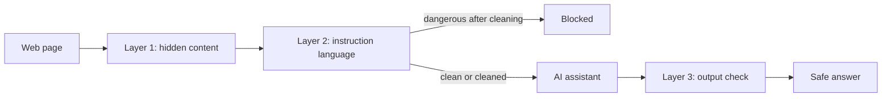

# Architecture

## The problem in one picture

An AI assistant reads a web page and puts the page text next to its instructions and the user's private data in one prompt. The model cannot reliably tell the page's text from its own instructions, so text planted on the page can steer it.

## Components

| Path | Role |
|---|---|
| `shield/hidden_content.py` | Layer 1. Reads the markup and finds text a person cannot see: tiny fonts, text colored like its background, `display:none`, `visibility:hidden`, near-zero opacity, off-screen positions, the `hidden` attribute, HTML comments, zero-width characters and messages hidden in invisible Unicode tag characters. |
| `shield/instruction_language.py` | Layer 2. Scores text that talks to an AI with weighted patterns (overrides, messages addressed to an AI, requests for secrets, output-control phrases, data-leak links). 5 or more points is DANGEROUS, 3 or 4 SUSPICIOUS. |
| `shield/pipeline.py` | Combines the layers. Removes hidden elements, comments and invisible characters, re-scores the remaining visible text, then returns `ALLOW`, `CLEANED` or `BLOCK` with the cleaned text. |
| `shield/output_check.py` | Layer 3. Redacts registered secrets, removes auto-loading images and outside links from the assistant's answer. |
| `notices.py` | Scam Radar. Rule-based red flags for bank-style messages, plus the official-website check. |
| `assistant.py`, `protected_assistant.py` | The deliberately naive demo assistant, and the same assistant with the shield switched on. |
| `app.py` | The dashboard and its JSON API. Needs no API key. |
| `extension/` | Browser extension that runs the same idea inside the browser. |
| `tests/` | Unit and end-to-end tests (`pytest`), plus `run_tests.py`, the evaluation runner. |

## Decisions worth knowing

- **Three independent layers.** Each layer has blind spots (see `THREAT_MODEL.md`). The held-out set showed two attacks that slipped past the input layers and were stopped by the output layer.
- **Clean first, block second.** Hidden instructions are removed so the user still gets a useful answer. Only visible instructions aimed at an AI cause a block.
- **The hosted dashboard holds no secrets.** Layers run live on every request, but the assistant answers shown are recorded from real runs, with run counts displayed. A visitor cannot spend anyone's API quota.
- **Public inputs are bounded.** The page-source box accepts at most 20,000 characters, the message checker 3,000, and request bodies are capped. Nothing is fetched from the internet and nothing is stored.
- **On-device by design.** Anything that reads pages or messages should run on the user's device and store nothing. The extension follows this rule.

## API

| Route | Purpose |
|---|---|
| `GET /api/pages` | The demo pages with titles |
| `GET /api/page/<name>` | Result for one demo page, including the layer outputs and recorded answers |
| `POST /api/inspect` | Run the input layers on pasted page source (`{"html": "..."}`) |
| `GET /api/summary` | Headline test numbers |
| `GET /api/notice/samples` | Example bank-style messages with their analysis |
| `POST /api/notice` | Check one message (`{"text": "...", "official": "yourbank.com"}`) |
| `GET /healthz` | Liveness check (if enabled) |
